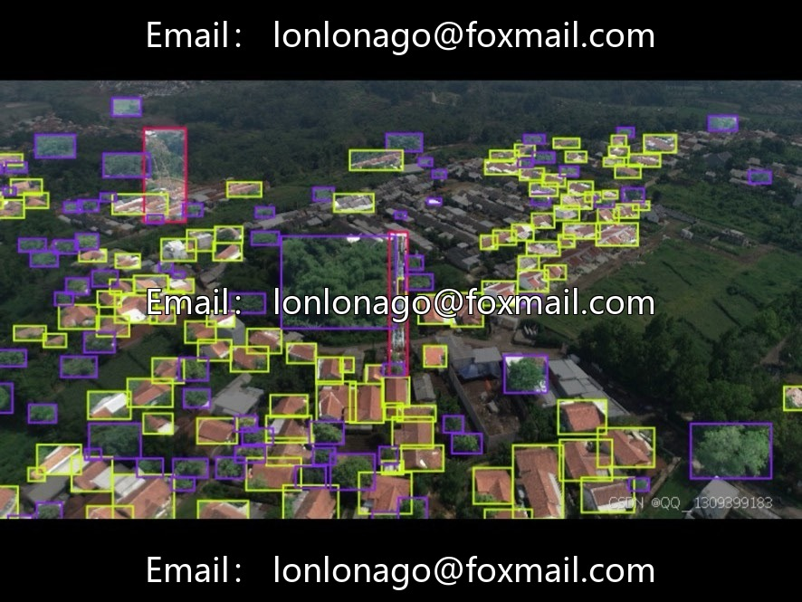
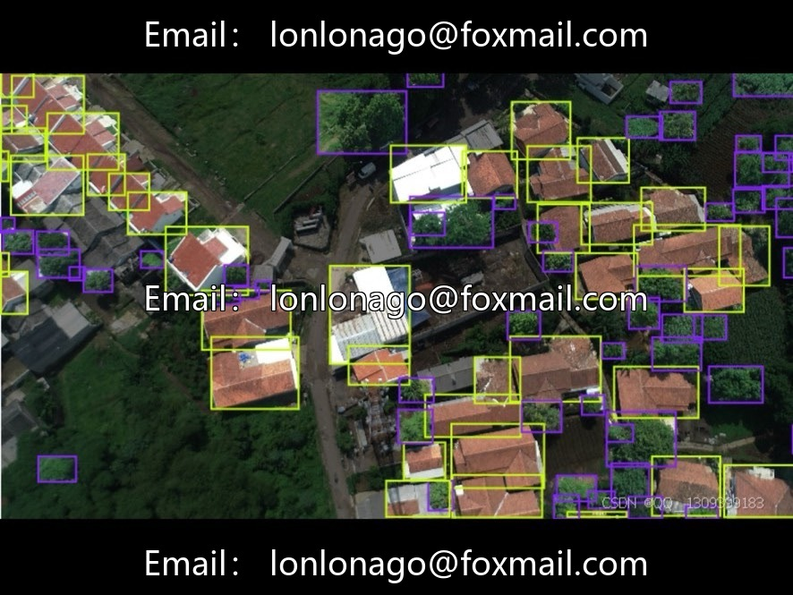
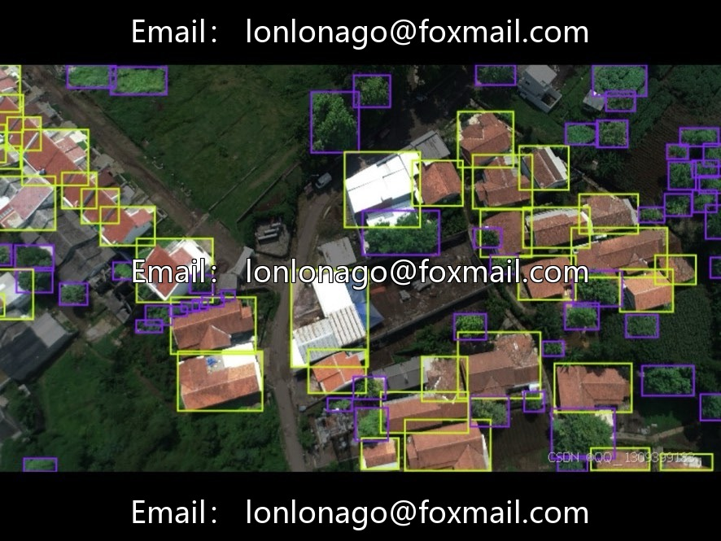
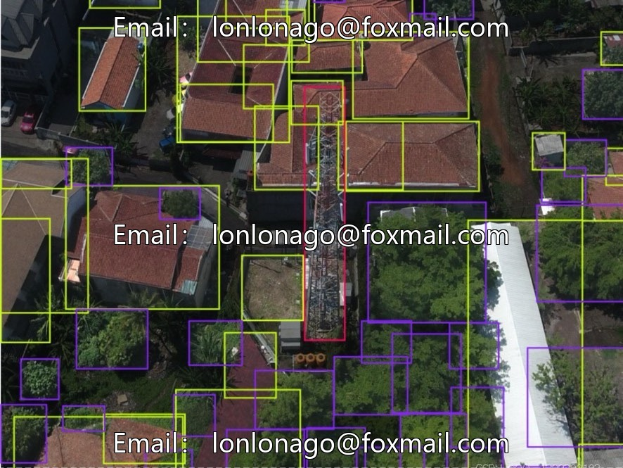
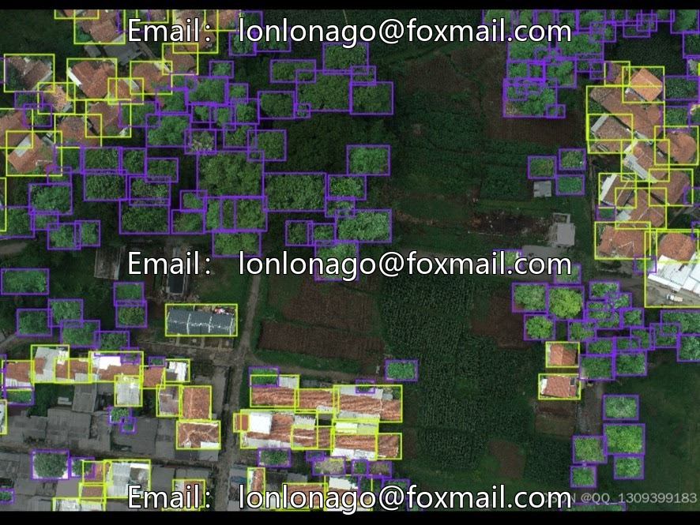

# DJI Aerial Photography House Tower and Tree Target Detection Dataset | Issue 10053

## Body

DJI Aerial Photography House, Tower, and Tree Target Detection Dataset | Issue 10053
DJI aerial photography images for low-altitude urban ground objects detection, suitable for low-altitude surveying and mapping, smart city inspection algorithm training.
I. Basic Scale
A total of 1000 aerial imagery, medium scale, with up to 183 labeled boxes per image, abundant samples of houses and trees, rich annotation information, suitable for basic model tuning and algorithm validation.
II. Three-Class Annotation Objects
1. House (Buildings): Single-story, contiguous buildings, the sample proportion is the highest.
2. Tower (Signal/Communication Tower): High-rise structures, with high structural feature recognition.
3. Trees (Trees): Single-tree, full coverage of forested areas.

Specify the training set samples, with a fixed number of unpublished test sets, and divide the training and testing subsets according to an industry-standard 8:2 ratio.
IV. Image Resolution
Unified high-definition specifications 2720×1530, with clear details, complete roof, tower body, and tree crown textures, with low preprocessing costs.
V. Application scenarios
1. Smart City Planning: Automatically count the distribution of houses and communication towers, monitor urban expansion.
2. Ecological Greening Monitoring: Identify the extent of vegetation coverage, track changes in forested areas.
3. Geographic Information Surveying and Mapping: Quickly extracting the coordinates of land features, updating the map database
4. Post-disaster assessment: Aerial photography to identify damaged houses and fallen trees, assisting in rescue planning.
5. Rural Resources Survey: Statistics on the distribution of rural residential and greening areas, supporting rural development planning.

Virtual materials, once sold, are non-refundable.
Interested friends, click "I want" to proceed.

## Images

## Payment

Here is a pay link on Stripe ( https://buy.stripe.com/3cs8yP7sY87d0vu9AB ). Please contact me lonlonago@foxmail.com after funding $89, and I will send you a complete data files , thank you!

